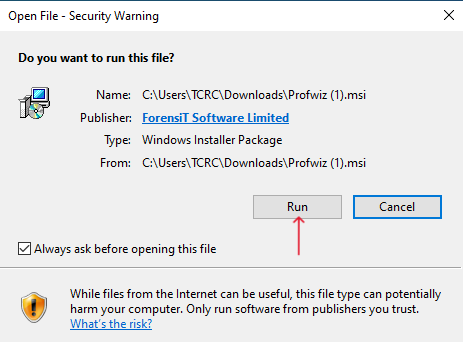
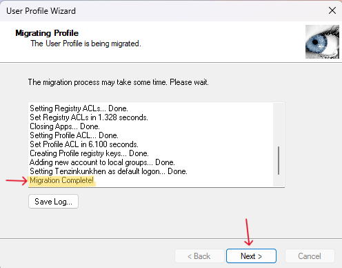

# Windows User Profile Migration to Microsoft Entra ID Using ForensiT ProfWiz

## Step 1: Connect the Device to Microsoft Entra ID

- Sign in to the computer using a local administrator account.

- Connect the device to Microsoft Entra ID using the administrator account and complete the device-joining process.

- Once the process is complete, sign out of the administrator account.

## Step 2: Sign In With the New User Account

- From the Windows sign-in screen, select Other user.

- Enter the user's Microsoft Entra ID email address and password.

- Complete the initial Windows Hello Pin and user profile setup.

- Open Company Portal and complete the required device setup, enrollment, and compliance steps, if applicable.

- Sign out of the user account.

## Step 3: Migrate the Existing User Profile Using ForensiT ProfWiz

- Sign back in using the local administrator account.

- Download and install ForensiT User Profile Wizard (ProfWiz) from the official website: https://www.forensit.com/

- Run ProfWiz with administrator privileges.

- Select the existing Windows user profile that needs to be migrated.

- Select the corresponding Microsoft Entra ID account as the target account.

- Follow the wizard's instructions to complete the profile migration.

- Restart the computer if prompted.

This is the recommended and safest approach with ProfWiz.

1. **Download the User Profile Wizard**  
   - Search for "ForensiT" on Google or go to [Forensit.com](https://www.forensit.com) to download the User Profile Wizard.

   

2. **Go to the Free Download Section**  
   - Navigate to the *Free Download* section of the website.

   

3. **Download the User Profile Wizard for Windows**  
   - Choose the appropriate version of the User Profile Wizard for your Windows operating system and click *Download*.

   

4. **Install the User Profile Wizard**  
   - After downloading, click on the installer file and select *Run* to begin the installation process.

   

5. **Accept the Terms and Conditions**  
   - Review and accept the terms and conditions to proceed with the installation.

   

6. **Launch the User Profile Wizard**  
   - After installation, launch the program by clicking on the User Profile Wizard icon on your desktop.

   

7. **Open the User Profile Wizard**  
   - Click *Next* to begin the profile migration process.

   

8. **Select the Profile to Migrate**  
   - Choose the user profile you wish to migrate and click *Next*.

   

9. **Enter the Account Name**  
   - Provide the new account name for the migration and click *Next*.

   

10. **Start the Profile Migration**  
   - The migration process will begin. Once it completes, click *Next* to proceed.

   

11. **System Restart**  
   - The system will automatically **restart** and load the new migrated account.

## Step 4: Sign In and Verify the Migrated Profile

- Sign in using the user's Microsoft Entra ID credentials.

- Verify that the existing desktop, documents, downloads, and other required user data are available.

- Confirm that the user's applications, settings, and access permissions are working correctly.

- Verify that the device is properly enrolled in Microsoft Intune and that the required company policies and applications have been applied.

**⚠️ Warning: Do Not Skip Step 2**

Complete the initial sign-in with the new Microsoft Entra ID user account and finish the required Company Portal setup before proceeding to Step 3.

**If you skip this step,** ForensiT ProfWiz may encounter a missing `ForensiTAzureID.xml` file error, which can be difficult to troubleshoot and resolve.

**Action required:** Verify that the user can sign in successfully and that the initial profile setup is complete. Then sign out, switch back to the local administrator account, and proceed with the ForensiT profile migration.